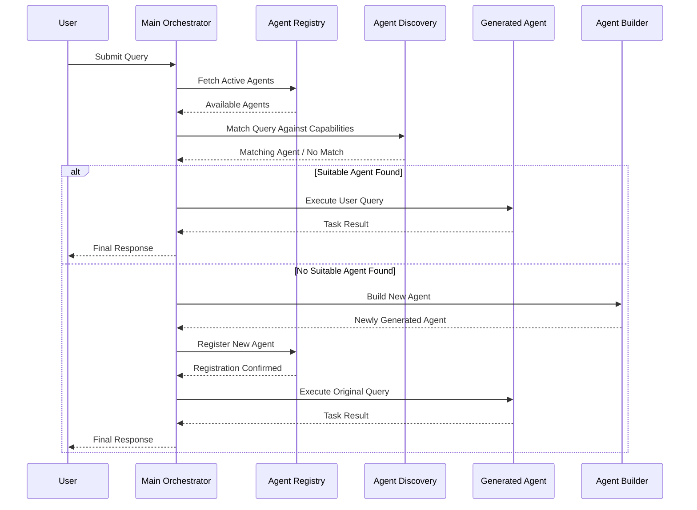

Below is a detailed Product Requirements Document (PRD) for your Tectonic platform. I've structured it so that it can be shared directly with your development team or provided to an AI coding agent (Claude Code, Cursor, GitHub Copilot, etc.) to modify the existing implementation.

The key architectural change is to introduce Generated Agent Discovery and Intelligent Routing into the main orchestrator, ensuring that the Agent Builder is invoked only as a fallback.

# PRD: Intelligent Agent Discovery and Dynamic Routing for Tectonic

**Product:** Tectonic – Universal Task Automation Platform
**Feature:** Generated Agent Discovery & Intelligent Query Routing
**Priority:** High
**Type:** Architecture Enhancement / Orchestrator Workflow Optimization

---

## 1. Background

Tectonic is a universal task automation platform where users can submit queries or requests to automate different types of tasks.

The platform uses an agent-based architecture consisting of:

1. **Main Orchestrator Agent:** Receives user queries and determines how they should be processed.
2. **Agent Builder:** Dynamically creates new agents when an existing agent cannot handle a user's request.
3. **Generated Agents:** Specialized agents created dynamically by the Agent Builder to handle specific tasks.
4. **Agent Execution Layer:** Executes the selected agent and returns its response to the user.

### Current Implementation

Currently, every incoming user query is being forwarded to the Agent Builder.

This creates unnecessary agent creation attempts, even when a previously generated agent could already handle the user's request.

### Problem Statement

The current architecture does not sufficiently leverage previously generated agents.

For example:

- User A asks: "Create a Python script to analyze an Excel file."
- Tectonic invokes the Agent Builder.
- The Agent Builder creates an Excel Analysis Agent.
- The agent successfully completes the task.

Later:

- User B asks: "Can you analyze this Excel file and generate a summary?"
- Instead of discovering and reusing the existing Excel Analysis Agent, Tectonic invokes the Agent Builder again.

This leads to:
- Unnecessary agent creation.
- Duplicate agents with overlapping capabilities.
- Increased execution latency.
- Increased LLM/API consumption.
- Poor utilization of previously generated agents.
- Lack of centralized agent discovery and reuse.

---

## 2. Objective

Modify the existing Main Orchestrator Agent so that it follows an intelligent agent discovery and routing strategy.

**Primary requirement:**

Whenever a user submits a query, the Main Orchestrator must first inspect the registry of previously generated agents and determine whether any existing agent can handle the request.

The Agent Builder should only be invoked when no suitable existing agent is available or when the existing agents cannot fulfill the requested task.

The system must prioritize agent reuse over agent creation.

---

## 3. Proposed Architecture

### New High-Level Workflow

User Query → Main Orchestrator → Generated Agent Discovery → Capability Matching → Existing Agent Execution OR Agent Builder Fallback.

### Expected Flow

1. User submits a query to Tectonic.
2. Main Orchestrator receives the query.
3. Orchestrator retrieves the available generated agents from the Agent Registry.
4. It evaluates the capabilities, descriptions, tools, and supported tasks of each available agent.
5. It determines whether an existing agent can handle the user's request.
6. If a suitable agent is found:
   - Route the query to that agent.
   - Execute the task.
   - Return the agent's response to the user.
7. If no suitable agent is found:
   - Invoke the Agent Builder.
   - Generate a new specialized agent.
   - Register the newly generated agent.
   - Execute the user's original query using the newly generated agent.
   - Return the response to the user.

---

## 4. Detailed Functional Requirements

### FR-01: Generated Agent Registry

The platform must maintain a centralized registry of all generated agents.

The registry should contain the following metadata wherever available:

| Attribute | Description |
|---|---|
| Agent ID | Unique agent identifier |
| Agent Name | Name of the generated agent |
| Agent Description | Purpose and responsibilities |
| Capabilities | Tasks the agent can perform |
| Supported Tools | Tools and integrations available |
| Input Schema | Supported input format |
| Output Schema | Expected output format |
| Agent Endpoint | Execution endpoint or callable reference |
| Status | Active, inactive, failed, deprecated |
| Owner/Scope | User, organization or global |
| Created At | Agent creation timestamp |
| Version | Agent version |

The orchestrator must retrieve only agents that are eligible for execution based on their status, permissions, and scope.

### FR-02: Agent Discovery

Before invoking the Agent Builder, the Main Orchestrator must perform agent discovery.

The discovery process should:

- Retrieve registered agents.
- Understand the user's intent.
- Compare the query against agent descriptions and capabilities.
- Identify one or more potentially suitable agents.
- Support semantic matching rather than relying only on exact keywords.
- Consider the tools and integrations required by the request.
- Respect user and organization-level access permissions.

The implementation should support vector-based semantic retrieval or another suitable agent-discovery mechanism.

### FR-03: Intelligent Agent Selection

When multiple agents match the user's request, the orchestrator should select the most appropriate agent.

Selection criteria should include:

1. Capability relevance.
2. Semantic similarity.
3. Tool availability.
4. Input/output compatibility.
5. Agent execution status.
6. User authorization.
7. Historical execution success, if available.

The orchestrator should avoid selecting an agent merely because its name or description contains similar keywords.

### FR-04: Existing Agent Execution

If an appropriate generated agent is identified:

- The orchestrator must invoke the existing agent directly.
- The original user query and required context must be passed to the agent.
- The agent must execute the requested task.
- The response must be returned through the existing Tectonic response mechanism.

The Agent Builder must not be invoked when an existing agent can fulfill the request.

### FR-05: Agent Builder Fallback

The Agent Builder must be invoked only when:

- No matching generated agent is found.
- Retrieved agents do not have the required capabilities.
- No eligible agent has the required tools or integrations.
- Existing agents cannot fulfill the task after reasonable execution or capability validation.

When a new agent is successfully generated:

1. Register the agent in the centralized registry.
2. Store its metadata and capabilities.
3. Make it discoverable for subsequent queries.
4. Execute the original user request using the newly generated agent.
5. Return the response.

**Important:** Agent registration must happen before the agent becomes available for subsequent discovery requests.

### FR-06: Dynamic Registry Updates

Whenever a new agent is generated, the registry must be updated automatically.

The Main Orchestrator must be able to discover newly registered agents without requiring a manual code deployment or restart.

Agent registration should support:

- Agent creation.
- Agent updates.
- Agent deactivation.
- Agent version changes.
- Capability metadata updates.

---


## 6. Important Architectural Considerations

### 6.1 Do Not Hardcode Generated Agents

The orchestrator must not maintain a hardcoded list of generated agents.

It must retrieve agent information dynamically from the registry or existing persistence layer.

### 6.2 No Manual Orchestrator Code Updates for Every New Agent

A critical requirement is that creating a new agent must not require modifying the orchestrator source code manually.

The orchestrator should use a dynamic discovery mechanism.

Once the Agent Builder creates and registers an agent, the agent should automatically become available to the discovery mechanism.

### 6.3 Multi-Agent Matching

If multiple agents can handle different parts of a complex request, the architecture should allow future support for multi-agent orchestration.

For the initial implementation, prefer a single best-matching agent whenever possible.

### 6.4 Failure Handling

Do not immediately invoke the Agent Builder whenever an existing agent encounters a temporary execution error.

Differentiate between:

- Capability mismatch.
- Missing permissions.
- Missing user input.
- Temporary execution failure.
- Tool/API failure.
- Agent unavailable.

Retry or recover from temporary errors where appropriate. Ask the user for missing information when needed. Invoke the Agent Builder only when the task genuinely requires a new capability.

### 6.5 Concurrent Agent Creation

Consider concurrent requests that attempt to create the same type of agent.

Implement duplicate detection or idempotent registration to minimize duplicate agent creation.

### 6.6 User and Organization Isolation

The discovery mechanism must respect agent ownership and access permissions.

A globally available agent should be reusable according to platform policies, while private user agents must not become accessible to unauthorized users.

---

## 7. Expected Sequence Diagram



---

## 8. Non-Functional Requirements

| Requirement | Expected Behaviour |
|---|---|
| Performance | Agent discovery should introduce minimal latency |
| Scalability | Support a growing number of generated agents |
| Maintainability | Avoid hardcoded agent definitions |
| Reliability | Handle unavailable agents and registry failures |
| Security | Enforce user and organization permissions |
| Observability | Log agent discovery and routing decisions |
| Extensibility | Allow new agent types without changing routing logic |
| Consistency | Ensure registered agents are immediately discoverable |

---

## 9. Logging and Observability

For every incoming query, capture:

- User query or a privacy-safe representation.
- Number of agents discovered.
- Matching agent IDs.
- Matching scores and selection rationale.
- Selected agent ID.
- Whether Agent Builder was invoked.
- Reason for invoking Agent Builder.
- Agent execution status.
- Execution latency.
- Final execution outcome.

This information should help identify whether Tectonic is effectively reusing generated agents.

---

## 10. Acceptance Criteria

The implementation will be considered successful when the following scenarios pass.

| ID | Scenario | Expected Result |
|---|---|---|
| AC-01 | First request for a new capability | Agent Builder creates a new agent |
| AC-02 | Same request submitted again | Existing agent is reused |
| AC-03 | Similar request with different wording | Existing agent is discovered semantically |
| AC-04 | Request requiring a completely new capability | Agent Builder is invoked |
| AC-05 | Multiple matching agents | Most appropriate agent is selected |
| AC-06 | Newly generated agent | Automatically registered |
| AC-07 | New agent registered | Available for subsequent queries without restart |
| AC-08 | Existing agent temporarily unavailable | Appropriate retry/error handling; no unnecessary agent creation |
| AC-09 | User lacks permission | Unauthorized agent is not selected |
| AC-10 | Agent metadata changes | Discovery uses updated capabilities |
| AC-11 | Existing agent cannot fulfill a task | Controlled fallback to Agent Builder |
| AC-12 | Agent Builder successfully creates an agent | Original query is executed by that agent |

---

## 11. Expected Before vs After Behaviour

### Current Behaviour

```text
User Query
    |
    v
Main Orchestrator
    |
    v
Agent Builder
    |
    v
Build Agent
    |
    v
Execute Agent
    |
    v
Response
```

### Expected Behaviour

```text
User Query
    |
    v
Main Orchestrator
    |
    v
Agent Discovery
    |
    v
Capability Matching
    |
    +-----------------------+
    |                       |
    v                       v
Existing Agent Found    No Matching Agent
    |                       |
    v                       v
Execute Existing        Agent Builder
    |                       |
    |                       v
    |                   Build Agent
    |                       |
    |                       v
    |                   Register Agent
    |                       |
    |                       v
    |                   Execute New Agent
    |                       |
    +-----------+-----------+
                |
                v
          Final Response
```

---

## 12. Implementation Instructions for the Development Team / AI Coding Agent

Please inspect the existing Tectonic codebase and understand the current implementation before making any modifications.

**The objective is to modify the existing orchestration flow, not to rebuild the platform.**

Perform the following activities:

1. Identify the current Main Orchestrator Agent implementation.
2. Identify how the Agent Builder is invoked.
3. Identify where generated agents are persisted or registered.
4. Understand how generated agents are currently executed.
5. Determine whether an existing agent registry, metadata store, vector database, or discovery mechanism is already available.
6. Reuse existing infrastructure wherever possible.
7. Modify the Main Orchestrator to perform generated-agent discovery before invoking the Agent Builder.
8. Implement intelligent capability matching and agent selection.
9. Ensure newly generated agents are automatically registered and discoverable.
10. Preserve all existing user-facing interfaces, APIs, authentication, context handling, and response formats.
11. Add appropriate error handling, logging, and tests.
12. Avoid introducing unnecessary infrastructure or dependencies.

### Important Development Constraint

Do not assume that a completely new agent registry or vector database is required.

First inspect the existing architecture. If generated agents and their metadata are already stored somewhere, reuse that mechanism.

If the current architecture does not support dynamic agent discovery, propose the smallest architectural change necessary to achieve it.

---

## 13. Final Expected Outcome

Tectonic should evolve from an agent-creation-first platform into an agent-discovery-first platform.

The Main Orchestrator should become intelligent enough to understand what the user wants, discover existing agents, select the right agent, and reuse its capabilities.

The Agent Builder should act as a fallback mechanism for capabilities that are not already available.

**Core Principle:**

"Discover First → Reuse Existing Agent → Build New Agent Only When Required → Register → Execute → Respond."

The ultimate goal is to make Tectonic a scalable, self-expanding agent ecosystem where every successfully generated agent becomes a reusable capability for future user requests.

### My additional architectural recommendation

There is one important distinction I recommend incorporating into the implementation.

Don't update the orchestrator's source code every time an agent is generated. Update the agent registry, not the orchestrator code.

The orchestrator should remain relatively static, while its knowledge of available agents changes dynamically.

Recommended architecture

Main Orchestrator

Stable routing and decision-making logic

Dynamic Agent Registry + Semantic Discovery

Continuously updated agent metadata and capabilities

Existing Agent

Match found

Execute directly

Agent Builder

Fallback

Create and register

This gives you three major benefits:

* No need to regenerate or modify orchestrator code every time.

* Every newly generated agent becomes reusable automatically.

* Tectonic can scale to hundreds or thousands of agents without continuously changing the main orchestration logic.

One additional recommendation: Introduce a confidence threshold for agent selection. For example, if the best matching agent has a confidence score below the configured threshold, invoke the Agent Builder rather than risking an incorrect agent execution.

The PRD above can be used as the implementation specification.